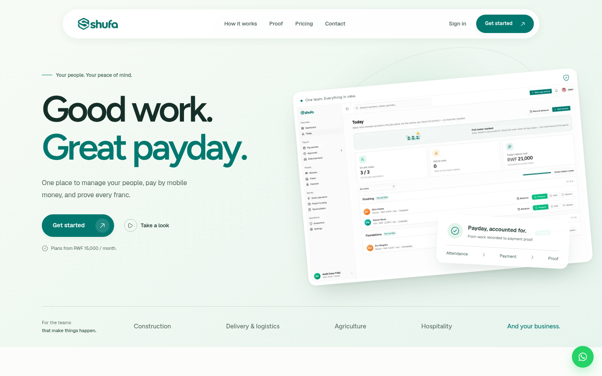
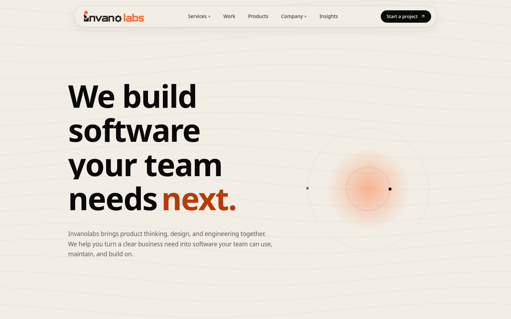
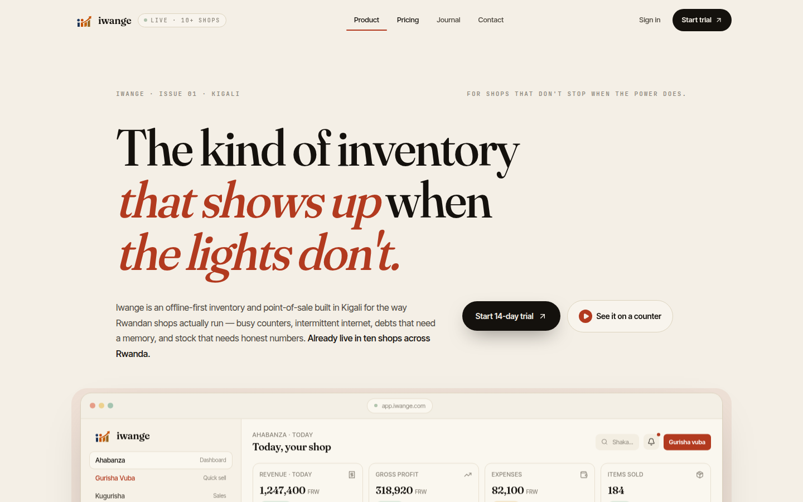
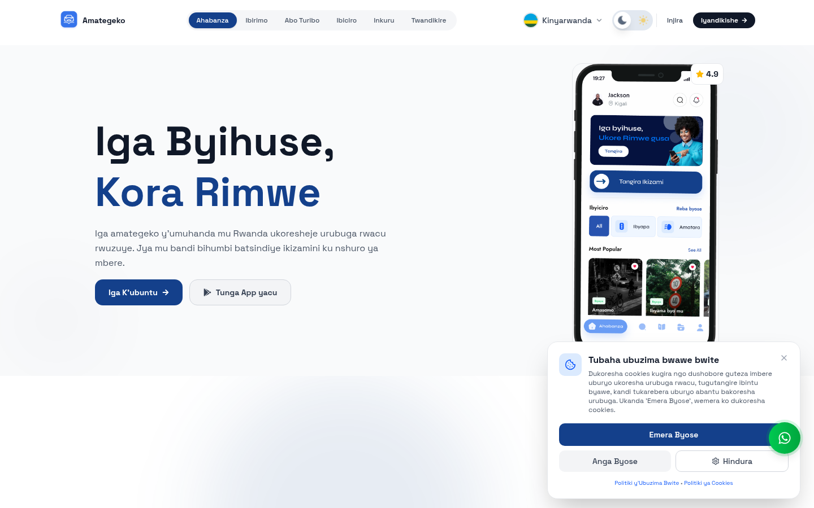
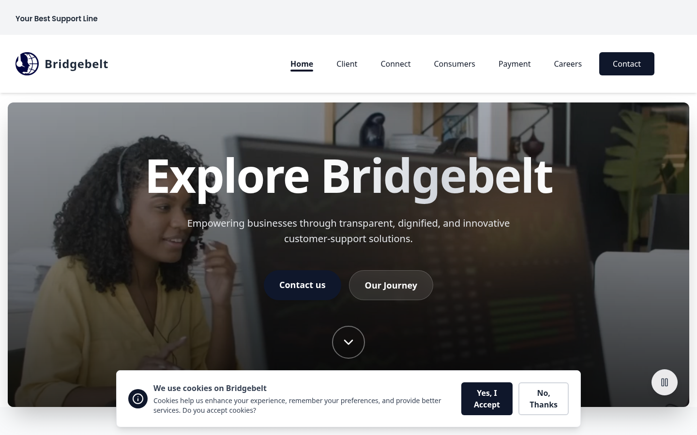

<picture>
  <source media="(prefers-color-scheme: dark)" srcset="./assets/header-dark.svg">
  <source media="(prefers-color-scheme: light)" srcset="./assets/header-light.svg">
  
</picture>

Production work by [Fabrice Nsanzimana](https://github.com/fason250) · software engineer, Kigali, Rwanda · [fason.dev](https://fason.dev)

This repo holds case studies, not source code. Client products stay with their owners; what lives here is the story of the work: the role, the stack, the outcome.

---

### 01 · Shufa · workforce payroll

- **what** · attendance becomes a sealed payout list; every mobile-money franc lands with proof
- **role** · software engineer at [Invano Labs](https://www.invanolabs.com/), building the product end to end
- **stack** · Next.js · TypeScript · MTN MoMo · server-signed payout seals
- **link** · [shufa-brown.vercel.app](https://shufa-brown.vercel.app/)

---

### 02 · Invanolabs · the studio's own site

- **what** · brand, pages, and motion for a software studio: product thinking, engineering, and no loose ends
- **role** · designed and built in-house, owned end to end
- **stack** · Next.js · TypeScript · motion design
- **link** · [invanolabs.com](https://www.invanolabs.com/)

---

### 03 · Iwange · offline-first point of sale

- **what** · inventory and POS built for busy counters, intermittent internet, and stock that needs honest numbers
- **role** · engineering and design
- **stack** · offline-first architecture · Next.js · local-first data
- **status** · live in ten shops across Rwanda
- **link** · [iwange.com](https://iwange.com/) · [app.iwange.com](https://app.iwange.com/)

---

### 04 · Amategeko · driving-rules school

- **what** · Rwanda's online driving-rules learning platform: course engine, payments, progress tracking
- **role** · co-developed at [Switchiify](https://www.switchiify.com/): payments integration, course management, user progress
- **stack** · React · NestJS · MTN MoMo · PostgreSQL
- **link** · [amategeko.rw](https://amategeko.rw)

---

### 05 · BridgeBelt · AI voice agents

- **what** · AI-powered call-center platform for a U.S. client: multi-agent voice workflows handling real calls
- **role** · led the full engineering lifecycle: architecture, Node.js backend, React frontend, delivery
- **stack** · Vapi · Twilio · Node.js · Express · React · TypeScript · Stripe
- **link** · [bridgebelt.com](https://bridgebelt.com/)

---

### confidential

Two further engagements are under NDA: a multi-agent voice SaaS for a U.S. client (architecture, workflows, billing, delivery) and public-sector management-information systems (dashboards, field data collection, reporting for national programs). The best of that work I can't show. Ask me about it.

---

### reach

- portfolio · **[fason.dev](https://fason.dev)**
- linkedin · [/in/nsanzimana-fabrice](https://www.linkedin.com/in/nsanzimana-fabrice)
- email · `fabrice.nsanzimana2004@gmail.com`
- whatsapp · [+250 792 330 514](https://wa.me/250792330514)

*open to remote and full-time roles · replies within a day*
